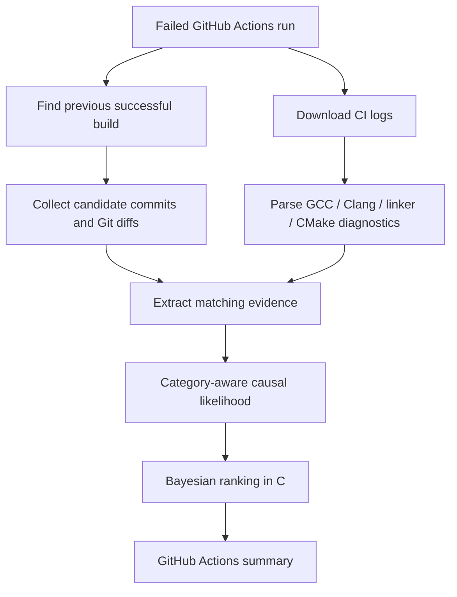

<div align="center">

# BayesCI

### Find the commit behind a broken C/C++ build.

**A lightweight GitHub Action that analyzes failed build logs and Git history, then ranks the commits most likely to have caused the failure.**

[](https://github.com/austinkilla228-art/BayesCI)
[](https://www.python.org/)
[](https://github.com/austinkilla228-art/BayesCI)
[](https://docs.github.com/en/actions)

**[Quick start](#quick-start)** · **[How it works](#how-it-works)** · **[Supported diagnostics](#supported-diagnostics)** · **[Limitations](#limitations)**

</div>

---

## Why BayesCI?

A failed CI run tells you **what** broke. Finding **which commit** introduced the problem can still mean inspecting multiple diffs, build settings, and linker messages.

BayesCI helps narrow the search. It compares the failed build with the latest relevant successful build, extracts signals from compiler and CMake logs, matches them against Git diffs, and produces a ranked shortlist in the **GitHub Actions job summary**.

- **Automatic:** runs after a GitHub Actions workflow fails.
- **Evidence-aware:** uses changed files, changed lines, symbols, and build configuration.
- **Native Bayesian core:** a small C engine updates and ranks candidate scores; Python handles parsing and Git integration.
- **No hosted backend:** runs inside GitHub Actions; no external BayesCI service required.
- **Uncertainty-aware:** reports insufficient evidence instead of inventing a winner when candidates cannot be distinguished.

> BayesCI is a **triage assistant**, not a proof of causation. Its scores are **normalized heuristic scores**, not empirically calibrated probabilities.

## Example output

When a C/C++ build fails, the analysis workflow writes a summary similar to this:

```text
BayesCI — failed CI analysis

Last successful commit: ae267617840e
Failed commit:          585444de9cde
Candidates:             3

Rank   Commit        Relative score
1      585444de      67.4%
2      a9e9939f      24.1%
3      fb45e076       8.5%
```

*Illustrative output, not the result of a particular run. A higher score indicates stronger evidence within the candidate set—not a guaranteed culprit.*

## Quick start

BayesCI is designed to run **after** your existing CI workflow. You do not need to replace your compiler, CMake configuration, or current build steps.

**1.** Make sure your existing workflow has a name, for example:

```yaml
# .github/workflows/ci.yml
name: CI

on:
  push:

jobs:
  build:
    runs-on: ubuntu-latest
    steps:
      - uses: actions/checkout@v4
      - name: Build
        run: |
          cmake -S . -B build
          cmake --build build
```

**2.** Add `.github/workflows/bayesci.yml` to the **default branch** of your repository:

```yaml
name: BayesCI analysis

on:
  workflow_run:
    workflows: ["CI"]
    types: [completed]

permissions:
  actions: read
  contents: read

jobs:
  diagnose:
    if: ${{ github.event.workflow_run.conclusion == 'failure' && github.event.workflow_run.event == 'push' }}
    runs-on: ubuntu-latest

    steps:
      - name: Checkout failed revision
        uses: actions/checkout@v4
        with:
          ref: ${{ github.event.workflow_run.head_sha }}
          fetch-depth: 0
          persist-credentials: false

      - name: Analyze failed build
        uses: austinkilla228-art/BayesCI@v1.0.0
        with:
          github-token: ${{ secrets.GITHUB_TOKEN }}
          repository: ${{ github.repository }}
          workflow-id: ${{ github.event.workflow_run.workflow_id }}
          branch: ${{ github.event.workflow_run.head_branch }}
          failed-sha: ${{ github.event.workflow_run.head_sha }}
          run-id: ${{ github.event.workflow_run.id }}
```

**3.** Push a commit. When the `CI` workflow fails, **BayesCI analysis** runs separately. Open that run and view its **Summary**.

**Before the first tagged release:** replace `@v1.0.0` with `@main` for testing. Switch back to `@v1.0.0` once that release exists. The `workflows: ["CI"]` value must match your actual CI workflow name. This integration uses a push-triggered CI workflow; other trigger types have not yet been validated.

### Action inputs

| Input | Purpose |
| --- | --- |
| `github-token` | Read build runs and logs via the GitHub API |
| `repository` | `owner/repo` to analyze |
| `workflow-id` | Workflow containing the failed run |
| `branch` | Branch whose history is being inspected |
| `failed-sha` | Commit tested by the failed build |
| `run-id` | Failed GitHub Actions run ID |

The example supplies these values automatically from the `workflow_run` event. The workflow requires `actions: read` and `contents: read` only.

## How it works



BayesCI considers commits between the selected last successful build and the failed revision. For each commit, it extracts evidence such as:

| Evidence | What it indicates |
| --- | --- |
| `file` | The commit changed a file named by a diagnostic |
| `line` | Its diff touched a line associated with the diagnostic |
| `symbol` | A referenced symbol occurs in changed lines |
| `build` | The commit modified build-related configuration |

The current **causal mixture** scoring model groups signals into plausible source, symbol, and build-related explanations, with weights conditioned on the diagnostic category. A native C engine then normalizes the resulting weights and orders candidate commits.

The score is relative to the candidates and the available evidence. A build can also fail because of external services, dependencies, environment changes, or nondeterministic behavior, in which case **no candidate commit may be the real cause**.

## Supported diagnostics

| Source | Examples | Status |
| --- | --- | --- |
| GCC / Clang | Syntax errors, missing headers, undeclared identifiers, invalid compiler flags | Supported patterns |
| GNU ld / lld | Undefined references, duplicate definitions, missing libraries | Supported patterns |
| CMake | Missing sources, unknown commands, invalid targets or configuration | Supported patterns |
| Runtime / test failures | Segfaults, assertions, failing test expectations | **Not analyzed** |

The parsers are intentionally focused on **build and link failures**. They do not recognize every message emitted by every compiler or build system.

## Benchmark snapshot

On a small set of **20 synthetic C/CMake failure scenarios** used during development:

| Measure | Result |
| --- | ---: |
| Scenarios with recognized diagnostics | **20 / 20** |
| True culprit in Top 3 | **19 / 20** |
| True culprit placed first (including ties) | **15 / 20** |
| Unique correct first-place result | **11 / 20** |

These are **development benchmarks, not an independent estimate of real-world accuracy**. Ties count toward the first-place result above, and the scores have not been statistically calibrated. The tool still has known failure modes, including diagnostics originating from macros defined in other files.

## Local development

**Requirements:** Python 3.10+, a C compiler (GCC/Clang), and Git. The Python parsing and orchestration code uses the standard library.

Build the native library on Linux:

```bash
gcc -shared -fPIC -O2 -Iinclude -o libbayesci.so src/bayes.c -lm
```

Run the available tests:

```bash
python -m unittest discover -s tests -v
```

The native library must be built at the location expected by `main.py` before importing modules that use `ctypes`.

## Security and limitations

- **Do not execute code from the failed checkout** in this analysis workflow. The checked-out source is used for Git inspection, not building or running it.
- `workflow_run` jobs can be security-sensitive. Keep the token **read-only** and do not pass write-capable secrets to untrusted revisions.
- The analyzer depends on accessible workflow logs and a reachable previous successful build.
- A ranking is useful only when log diagnostics provide evidence that distinguishes candidates. Otherwise BayesCI should explicitly report **insufficient evidence**.
- The current release targets **C/C++ build failures**. General-purpose runtime root-cause analysis and support for other language ecosystems are outside its present scope.

For GitHub's `workflow_run` security guidance, see [Secure use of GitHub Actions](https://docs.github.com/en/actions/reference/security/secure-use).

## Project structure

```text
BayesCI/
├── action.yml           # GitHub Action entry point
├── action_runner.py     # Fetch logs, find commits, publish summary
├── github_ci.py         # GitHub Actions API integration
├── git_reader.py        # Commit history and diffs
├── gcc_clang.py         # GCC / Clang / linker diagnostics
├── cmake_parser.py      # CMake diagnostics
├── extract_features.py # File, line, symbol, and build evidence
├── likelihood.py       # Category-aware evidence scoring
├── main.py             # Python ↔ C bridge
├── include/             # C headers
├── src/                 # Native Bayesian engine
└── tests/               # Tests and development fixtures
```

## Status

**Pre-release:** the local C/CMake benchmark suite has been exercised, but the tagged public Action should be considered ready only after an end-to-end run from a separate repository succeeds.

Contributions, bug reports, and real-world CI logs (with secrets removed) are welcome via [GitHub Issues](https://github.com/austinkilla228-art/BayesCI/issues).

---

## License

BayesCI is open-source software licensed under the
[MIT License](LICENSE).

Copyright (c) 2026 austinkilla228-art.

<div align="center">

**BayesCI** · Less guessing. More evidence.

</div>
